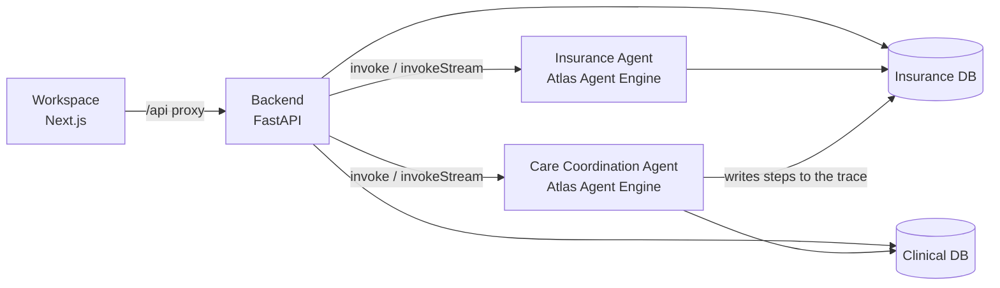

# Agentic Care Coordination for Health Insurance

A prior-authorization demo in which two cooperating agents, one administrative and one clinical, assess a member's treatment request, apply step-therapy criteria, and hand the case to a human medical director when a person needs to decide. Every step is written to a shared, auditable trace.

## The problem

Prior authorization needs two kinds of expertise that sit in different systems: administrative (is the member eligible, is the treatment covered under the plan) and clinical (does the member's history meet the guideline, did earlier therapies really fail). Reviewers gather this evidence by hand, which is slow and hard to apply consistently. It is also hard to explain afterwards why a case was approved or denied.

This solution assembles that evidence in one workflow and records the reasoning. The medical director keeps the final decision on cases that need one.

## What the solution does

* Runs a prior-authorization case end to end: open the case, check eligibility and coverage, review the clinical record, apply step-therapy criteria, recommend a decision, and route it.
* Splits the work across two agents with separate data access:
  * The **Insurance Agent** reads members, policies, plans and claims. It has no access to clinical data.
  * The **Care Coordination Agent** reads clinical profiles, pharmacy dispense history and guidelines. It has no access to insurance data.
* Uses one document, the **authorization trace** (`audit_log`), as the only channel between the agents. It holds the workflow stage, whose turn it is, step summaries, the outcome and the review. It contains no diagnosis text.
* Lets a medical director review escalated cases and record the final decision.
* Provides a member workspace with live case progress, reasoning, claim and clinical history, plan comparison, care gaps and a decision-tracing view.
* Provides a chat where you can talk to either agent directly.

## Where MongoDB Shines?

* **Flexible documents for the authorization trace.** A case is one document (`audit_log`) that holds the workflow stage, administrative gates, step summaries, the outcome and the review. Both agents add to it without a schema migration or joins across tables.
* **Atomic single-document updates.** Each stage transition is a compare-and-set on `workflow.stage`, so an agent calling a tool at the wrong stage is refused and two writers cannot overwrite each other.
* **Change streams for live progress.** The backend watches the trace collection (`workflow/watcher.py`) and streams case progress to the workspace as the agents write, instead of polling. This needs a replica set, which every Atlas cluster is.
* **Data isolation on one cluster.** Insurance and clinical data live in separate databases on the same cluster. Each agent connects to its own database, and the trace is the only shared record, so the Insurance Agent cannot read clinical data and the reverse. The backend is the only component that composes both.
* **Business-key indexes.** Unique indexes on `memberId`, `policyId`, `planId`, `claimId` and `traceId` keep lookups fast and prevent duplicate records (`python -m db.indexes`).
* **Agent memory on Atlas.** Atlas Agent Engine stores agent memory in MongoDB and embeds it with Voyage AI (`voyage-4-large`, 1,024 dimensions), so the agents can recall context across conversations.
* **Atlas as the platform.** One managed cluster serves the operational data, the audit trail and the agents' runtime state.

## Architecture

The solution has four main components:

* **Member and reviewer workspace — Next.js:** Member dashboard, live authorization progress, decision tracing, medical director review and agent chat. The browser only talks to this app, which proxies `/api/*` to the backend.
* **Application backend — Python FastAPI:** Starts and monitors cases, serves composed views of both databases, records the medical director's decision, seeds demo data and relays chat to the agents. It is the only component that holds both databases.
* **Two agents — Atlas Agent Engine (AAE):** `insurance-coordination-health-insurance` and `care-coordination-health-insurance`, built with the Agent Engine SDK on LangGraph. Each runs with its own tools and its own database.
* **Data layer — MongoDB Atlas:** One cluster, two databases, plus Voyage AI embeddings for agent memory.



### Data: two databases on one cluster

| Database | Collections | Used by |
|---|---|---|
| **Insurance** (`INSURANCE_DATABASE`) | members, policies, plans, claims, `audit_log` (the shared trace), `admin_reasoning` | Backend, Insurance Agent. The Care Agent reads and writes only `audit_log`. |
| **Clinical** (`CLINICAL_DATABASE`) | clinical profiles, dispense history, guidelines, `clinical_reasoning` | Backend, Care Agent |

Everything joins on business keys (`memberId`, `policyId`, `planId`, `claimId`, `traceId`, `guidelineId`), never on `_id`.

### Authorization flow

A case moves through a stage machine stored on the trace (`workflow.stage` and `workflow.nextActor`):

```
OPENED -> ADMIN_CLEARED -> (care agent) CLINICAL_RECOMMENDED -> ROUTED -> ESCALATED or CLOSED
   \__________ administrative denial ____________________________________/ CLOSED
```

1. The backend starts a case for a member. The Insurance Agent opens the trace and checks eligibility and coverage (`OPENED`, then `ADMIN_CLEARED`). An administrative denial closes the case here.
2. The Care Coordination Agent matches the request to the clinical record, classifies the treatment, reviews trial history and refill gaps, applies the step-therapy criteria, and records a recommendation with a confidence score (`CLINICAL_RECOMMENDED`).
3. The Insurance Agent routes the case (`ROUTED`). It either closes it or escalates it (`ESCALATED`).
4. A medical director reviews escalated cases in the workspace and records the decision. This is the only transition a person makes; the agents make all the others.

Every write is a compare-and-set on the current stage, so a tool called at the wrong stage is refused. A refused call means the action did not happen, and the agents are instructed to say so rather than report an outcome that was not recorded.

## Atlas Agent Engine foundation

Both agents are deployed on [Atlas Agent Engine](https://www.mongodb.com/docs/agentengine/), which provides agent execution, memory (Voyage AI `voyage-4-large`, 1,024 dimensions), durable workflows and sandboxed tool execution. The solution focuses on the insurance workflow: which evidence to gather, in what order, and who may see what.

The backend reaches the agents through `shared/aae_client.py`. It exchanges a service-account client ID and secret for an OAuth token, then calls `POST /api/v1/projects/{project}/workspaces/{workspace}/invoke` (`invokeStream` for chat). The workflow and the chat use the same client, so they cannot drift onto different deployments or credentials.

> Atlas Agent Engine is in Public Preview and is intended for evaluation and prototyping. See the [current limitations](https://www.mongodb.com/docs/agentengine/reference/limitations/).

## Tech stack

* Next.js 16 (App Router) and React 19, with [LeafyGreen UI](https://github.com/mongodb/leafygreen-ui) components
* Python 3.13, FastAPI, PyMongo, managed with [uv](https://docs.astral.sh/uv/)
* Atlas Agent Engine SDK with LangGraph
* MongoDB Atlas and Voyage AI

## Repository layout

```
backend/                                   FastAPI service (see backend/README.md)
frontend/                                  Next.js app
care-coordination-health-insurance/
  project-config.yaml                      Project-level Agent Engine settings (memory, Voyage)
  agents/insurance-coordination-health-insurance/   Insurance Agent
  agents/care-coordination-health-insurance/        Care Coordination Agent
environment/                               Kanopy config for staging and production
docker-compose.yml, Dockerfile.*           Container build (see "Run with Docker")
```

## Set up the solution

### Time and readiness

**Target: about 30–40 minutes once prerequisites and access are ready.** This assumes you already have an Atlas cluster, an Atlas Agent Engine organization and project, and the required credentials. First-time account setup, access approvals and agent deployment can take longer.

The order is: prepare the databases, deploy both agents, configure and start the backend, then start the frontend. Use a demo cluster only. `--reset` and `POST /reset-demo` clear and reload the demo collections.

### Prerequisites

* A MongoDB Atlas cluster, with database access and network access configured for your IP and for the agents.
* An Atlas Agent Engine organization and project, with the `agentengine` CLI installed and authenticated.
* A **service account** in that project with the `PROJECT_OWNER` role (required to invoke agents). Keep its client ID and secret private.
* A Voyage AI API key and an LLM API key for the model the agents use (see `llm.py` in each agent).
* Python `>=3.13,<3.14`, [uv](https://docs.astral.sh/uv/getting-started/installation/), Node.js 22 or newer, and npm.
* `make`. On Windows, use Git Bash or WSL, or run the commands inside the make targets directly.
* Docker, only if you want to run with containers.

### 1. Clone the repository

```bash
git clone <this-repository-url>
cd health-insurance-care-coordination
```

Optionally enable the secret-scanning pre-commit hook (see [Git hooks](#git-hooks-recommended)).

### 2. Choose your databases

Pick two database names on your cluster, for example `health_insurance` (insurance) and `health_clinical` (clinical). They are created when the seed runs. Use the same names in the backend and in each agent.

### 3. Configure and deploy the agents

Repeat this for each folder under `care-coordination-health-insurance/agents/`. Each agent reads its own `env.example`.

```bash
cd care-coordination-health-insurance/agents/insurance-coordination-health-insurance
cp env.example .env
```

Fill in `.env` with your own values:

| Agent | Variable | Meaning |
|---|---|---|
| Both | `MONGODB_URI` | Atlas connection string |
| Both | `LLM_API_KEY`, `VOYAGE_API_KEY` | LLM client and memory embeddings |
| Insurance | `MONGODB_DATABASE` | The **insurance** database |
| Care Coordination | `MONGODB_DATABASE` | The **clinical** database |
| Care Coordination | `AUDIT_DATABASE` | The **insurance** database (the agent writes only `audit_log` there) |

Review `agent.yaml` before deploying. Confirm the entry point, `features` (memory and durable workflow are on), the tool list, and `network.egress`. Egress must allow the agent to reach your LLM endpoint. Also check `llm.py` for the provider and model, and `../../project-config.yaml` for the memory settings.

Authenticate and register the workspace, then store the secrets on the platform and deploy:

```bash
agentengine auth login
agentengine init
agentengine secret set LLM_API_KEY --workspace-scope
agentengine secret set VOYAGE_API_KEY --workspace-scope
agentengine build
agentengine deploy
```

Do this for both agents. Keep the **project ID** and each agent's **workspace ID** for the backend configuration. Do not commit `.env` files.

To try an agent locally before deploying, run `agentengine dev up` in its folder and open the playground at `http://localhost:3000`. See each agent's `README.md`.

### 4. Configure the backend

```bash
cp backend/.env.example backend/.env
```

Fill in `backend/.env`:

| Variable | Meaning |
|---|---|
| `MONGODB_URI` | One connection string for both databases |
| `INSURANCE_DATABASE` | The insurance database. Falls back to `DATABASE_NAME`. |
| `CLINICAL_DATABASE` | The clinical database |
| `APP_NAME` | Optional app name sent to MongoDB |
| `AGENT_INVOKE_MODE` | `dry_run` (default) records what it would send and calls nothing. Any other value calls the deployed agents. **Set it, for example to `platform`, for the real demo.** |
| `AAE_CLIENT_ID`, `AAE_CLIENT_SECRET` | Service-account credentials |
| `AAE_PROJECT_ID` | Agent Engine project, shared by both agents |
| `INSURANCE_AGENT_WORKSPACE_ID`, `CARE_AGENT_WORKSPACE_ID` | One workspace per agent |
| `INSURANCE_AGENT_PROJECT_ID`, `CARE_AGENT_PROJECT_ID` | Optional per-agent override of `AAE_PROJECT_ID` |
| `AGENT_INVOKE_TIMEOUT`, `AGENT_TURN_GRACE_SECONDS`, `AGENT_GRACE_POLL_SECONDS` | Optional timing (defaults 900, 600 and 5 seconds) |
| `AAE_BASE_URL`, `AAE_API_ACCEPT`, `AAE_POOL_RETRIES` | Optional platform URL, pinned API version and retries |

A missing required variable returns a `503` that names it, never its value. Seed fixtures ship in `backend/seed/fixtures/`; set `SEED_FIXTURES_DIR` only to load them from elsewhere.

### 5. Install, create indexes and seed

```bash
make uv_init
make uv_sync
cd backend
uv run python -m db.indexes             # creates the business-key indexes in both databases
uv run python -m seed.seed_data         # upserts the demo data (add --reset to clear it first)
cd ..
```

The seed loads 6 synthetic members with their policies, plans, claims, clinical profiles, dispense history and guidelines. It is idempotent. No trace is seeded: you create it by running a case. `uv run python -m db.indexes --check` reports without creating anything.

### 6. Check the agent connection

```bash
cd backend
uv run python scripts/check_agents.py            # configuration and access token
uv run python scripts/check_agents.py --invoke   # also sends one harmless message to each agent
cd ..
```

### 7. Start the backend

```bash
cd backend
uv run uvicorn main:app --host 0.0.0.0 --port 8000
```

The health check is at `http://localhost:8000/health` and the interactive API docs at `http://localhost:8000/docs`. If port 8000 is busy, pick another port and point `BACKEND_URL` at it in the next step.

### 8. Configure and start the frontend

In another terminal:

```bash
cd frontend
npm install
npm run dev
```

The browser calls `/api/*` on the frontend, and `app/api/[...path]/route.js` proxies it to `BACKEND_URL` (default `http://localhost:8000`). Set `BACKEND_URL` in `frontend/.env.local` only if your backend is elsewhere. The `MONGODB_URI`, `DATABASE_NAME` and `NEXT_PUBLIC_API_BASE_URL` entries in `frontend/EXAMPLE.env` are not needed for the current proxy setup.

`npm run dev` serves the app on **`http://localhost:8080`**.

### 9. Verify the end-to-end workflow

1. Open `http://localhost:8080` and select a member. Confirm the member dashboard loads.
2. Start an authorization. Confirm that live progress advances through the stages, with reasoning from both agents.
3. When the case reaches `ESCALATED`, open the medical director review and record a decision.
4. Open the decision-tracing view and confirm the trace shows the steps, the outcome and the review.
5. Open the chat and send a message to each agent.

To repeat the demo, call `POST /reset-demo` (reset everything) or `POST /members/{member_id}/reset-demo` (reset one member).

## Run each part again

* **Backend:** `cd backend && uv run uvicorn main:app --host 0.0.0.0 --port 8000`
* **Frontend:** `cd frontend && npm run dev`
* **Agents:** from an agent folder, run `agentengine build` and `agentengine deploy` after changing it.

Keep the backend and frontend running in separate terminals.

## Run with Docker

```bash
make build    # build and start both containers
make stop     # stop them
make clean    # remove containers, images and volumes
```

The backend is exposed on `http://localhost:8000` and the frontend on `http://localhost:3000`. The compose file expects two external networks (`health-insurance-coordination_default` and `care-coordination_default`) and mounts `~/.aws` credentials. Create or adjust those first, and provide the backend environment variables from step 4. For day-to-day development, running locally is simpler.

## Tests

The backend tests are plain scripts that use in-memory MongoDB (`mongomock`). They need no cluster and no agents:

```bash
cd backend
uv run --with mongomock --with httpx python tests/test_backend.py
uv run --with mongomock --with httpx python tests/test_aae_transport.py
uv run python tests/test_boundaries.py
uv run --with mongomock python tests/test_seed_fixtures.py
```

See [backend/README.md](backend/README.md) for what each covers.

## Troubleshooting

| Symptom | What to check |
|---|---|
| A route returns `503` naming a variable | That environment variable is not set in `backend/.env`. Set it and restart the backend. |
| Starting a case does nothing and no agent runs | `AGENT_INVOKE_MODE` is still `dry_run`. Set it to call the deployed agents. |
| `check_agents.py` fails to get a token | Check `AAE_CLIENT_ID` and `AAE_CLIENT_SECRET`, and that the service account has the `PROJECT_OWNER` role in the project. |
| `check_agents.py --invoke` fails for one agent | Check that agent's workspace ID, and that the agent is deployed and its secrets were set with `agentengine secret set`. |
| An agent cannot reach the LLM or Atlas | Review `network.egress` in `agent.yaml` and the Atlas network access list. |
| A turn times out (`AGENT_TIMEOUT` 504) | The backend keeps reading the case for `AGENT_TURN_GRACE_SECONDS` before failing. Raise it, or `AGENT_INVOKE_TIMEOUT`, for slow models. |
| Members or data are missing | Run the seed against the databases named in `INSURANCE_DATABASE` and `CLINICAL_DATABASE`. Use `--reset` if a previous run left partial data. |
| Index creation fails on a unique index | The collection already holds duplicate business keys. Seed with `--reset`, then rerun `db.indexes`. |
| The frontend shows "Backend unreachable at …" | Start the backend and check `BACKEND_URL` in `frontend/.env.local`. |
| Port 8000 or 8080 is in use | Stop the other process or `make clean`, or use another port and update `BACKEND_URL`. |


